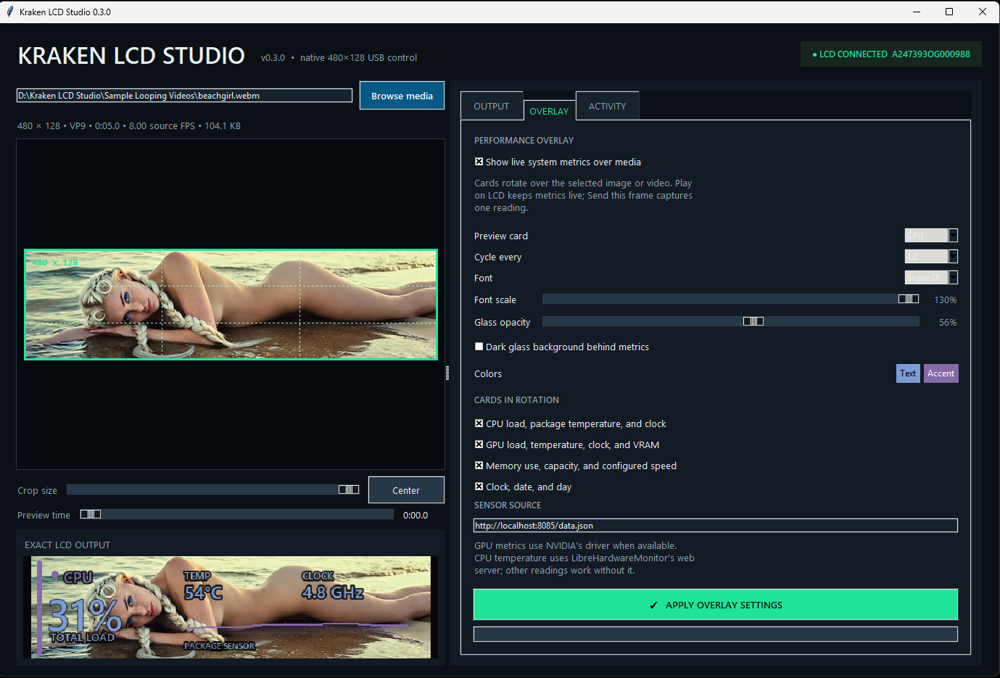

# Kraken LCD Studio

[](https://github.com/krakenunbound/kraken-lcd-studio/actions/workflows/ci.yml)
[](https://github.com/krakenunbound/kraken-lcd-studio/releases)
[](LICENSE)

Kraken LCD Studio is a lightweight native Windows controller and visual media
cropper for the Thermaltake 3.9-inch 480×128 LCD panel (`VID 264A`, `PID 233D`,
part `AC-073-OO1NAN-A1`). It controls the panel directly through Microsoft's HID
driver—no TT RGB Plus, replacement USB driver, or packet sniffer is required.

Version: **0.3.1**



## What it does

- Detects the live HID interfaces and displays the panel serial number.
- Opens images, GIFs, MP4, WebM, MKV, MOV, AVI, and animated WebP.
- Shows a draggable, locked 480:128 crop frame over the source.
- Provides a separate exact 480×128 output preview.
- Scrubs to a representative frame when cropping video.
- Controls crop size, position, rotation, FPS, JPEG quality, speed, and looping.
- Streams directly to the LCD or sends a retained static frame.
- Starts hidden at Windows sign-in and restores the last played LCD setup.
- Lives in the notification area, keeps playback running when its window closes,
  and provides quick access to saved profiles.
- Composites rotating CPU, GPU, memory, and clock cards over any image or video,
  with configurable colors, font, scale, opacity, card selection, and timing.
- Exports pre-cropped 480×128 JPG, H.264 MP4, or VP9 WebM files.
- Stops ffmpeg, heartbeat threads, and USB handles cleanly.

## Quick start

1. Install Python 3.12 and put ffmpeg/ffprobe on `PATH`.
2. Close TT RGB Plus completely.
3. Run `Install Kraken LCD Studio.cmd` once.
4. Double-click `Launch Kraken LCD Studio.cmd`.
5. Drag media from Explorer into the preview, or click **Browse media**.
6. Drag the green crop frame over the desired part of the source.
7. Click **Play on LCD**, **Send this frame**, **Export as MP4 or WebM**, or the
   dedicated **Convert MP4 → WebM** action.
8. Closing the window hides it in the notification area; use the tray icon's
   **Exit** command to stop the companion completely.

See [INSTALL.md](INSTALL.md) for complete installation, sensor setup, updating,
uninstalling, and troubleshooting instructions.

The installer enables **Start hidden with Windows**. The option can be changed
from the bottom of the Studio window or its notification-area menu. The setup
last sent with **Play on LCD**—including media, crop, rotation, speed, FPS,
quality, and looping—is restored after the next sign-in.

## Performance overlay

Open the **Overlay** tab and enable **Show live system metrics over media**. The
exact LCD preview uses representative values while you customize the design.
Click **Play on LCD** for live readings. Static images refresh at a low rate when
the overlay is enabled so their metrics and clock remain live.

Disable **Dark glass background behind metrics** for a fully transparent
overlay. Text shadows preserve readability without dimming the underlying
image. **Glass opacity** can also be reduced all the way to 0%.

The color buttons open a live palette: dragging immediately previews the color
in the Studio and on an active LCD stream. **Cancel** restores the prior color;
**OK** keeps and saves it. Use **Reset overlay defaults** to restore the complete
recommended design after confirmation.

CPU load/clock and memory load/capacity/speed use `psutil` and Windows hardware
information. NVIDIA GPU load, temperature, clock, and VRAM use `nvidia-smi`
from the installed display driver. For CPU package temperature—or GPU sensors
on AMD/Intel—run LibreHardwareMonitor and enable its web server at
`http://localhost:8085/data.json`. The overlay continues to work with `--` for
any sensor whose provider is unavailable.

Personal media, profiles, configuration, and logs are intentionally excluded
from the repository and release archives.

## WebM

WebM works as an input and export format. VP9 WebM is often smaller on disk than
H.264 MP4, but it usually costs more CPU to encode and decode. The source format
does not change live USB traffic: every displayed frame is decoded and sent to
the panel as a baseline JPEG packet stream.

For ordinary use, MP4/H.264 is the fastest and most broadly compatible choice.
WebM is useful when disk size matters more than encode/decode speed.

## Requirements

- Windows 10 or 11
- Python 3.12
- ffmpeg and ffprobe on `PATH`
- Pillow, pywinusb, tkinterdnd2, pystray, and psutil (installed by setup)
- Thermaltake LCD connected by its USB cable

See [User Guide](docs/USER_GUIDE.md), [Limitations](docs/LIMITATIONS.md), and
[Protocol Notes](docs/PROTOCOL.md) for details. See [Contributing](CONTRIBUTING.md)
for the development workflow.

## Command-line fallback

```powershell
py -3.12 thermaltake_lcd.py info
py -3.12 thermaltake_lcd.py --verbose test
py -3.12 thermaltake_lcd.py play kraken_loop.mp4 --fps 8
```

## Project status

This is an independent community project, not affiliated with or endorsed by
Thermaltake. The exact connected hardware above has been tested on Windows.
Other Thermaltake LCD products may use different resolutions or commands.

Protocol behavior was validated against
[`bekindpleaserewind/ttlcd`](https://github.com/bekindpleaserewind/ttlcd), the
GPL-3.0 Linux implementation for this device family. Kraken LCD Studio is
licensed under GPL-3.0-or-later; see [LICENSE](LICENSE).
